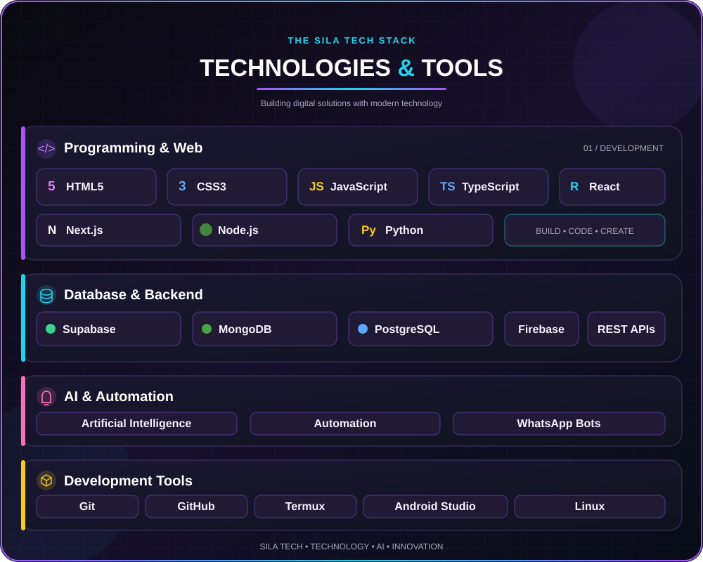
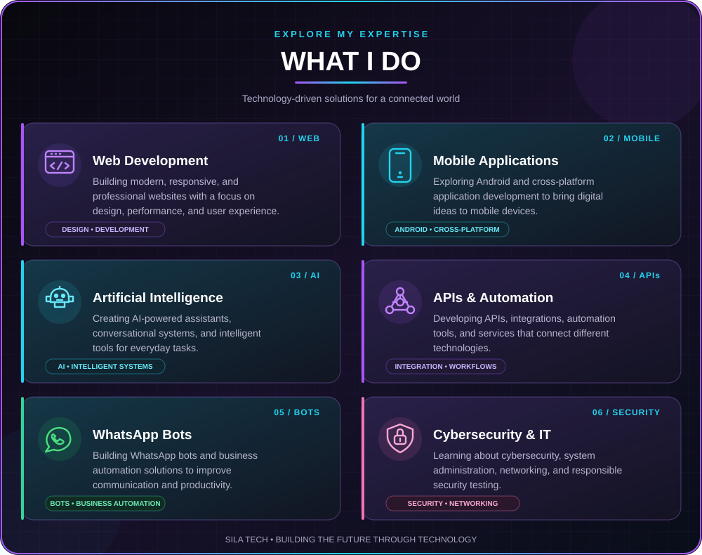

<!-- MAIN SILA TECH BANNER -->

 

<!-- ANIMATED TITLE -->

 

<!-- TYPING ANIMATION -->

  

<!-- PROFILE VISITOR COUNTER -->

  

---

<h2 align="center">👨‍💻 About Me</h2>

**Welcome to my digital world.**

I am **Sila Tech**, a technology enthusiast focused on building modern digital solutions through web development, mobile applications, artificial intelligence, APIs, automation, and WhatsApp bots.

My goal is to transform ideas into useful, reliable, and professional technology products.

---

<!-- TECHNOLOGIES AND TOOLS SVG -->

---

<!-- SERVICES SVG -->

---

<h2 align="center">📊 Github Stats</h2>

  

---

<h2 align="center">Connect With Sila Tech</h2>

---

 

**Turning ideas into technology. Building solutions for tomorrow.**

Designed with passion by SILA TECH

