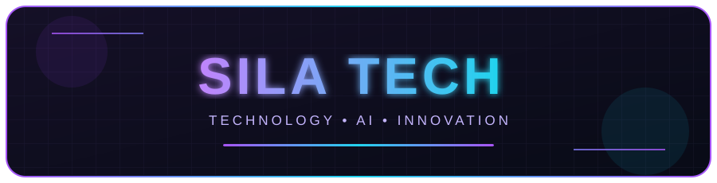

  
  

  
  

  Web Development • Mobile Apps • Artificial Intelligence • APIs • WhatsApp Bots

---

### 👨‍💻 About Me

I'm **Sila Tech**, a developer and technology enthusiast passionate about building modern digital solutions, intelligent systems, and innovative software.

- 🌐 Developing modern websites and web applications.
- 📱 Exploring Android and iOS application development.
- 🤖 Creating AI-powered applications and intelligent assistants.
- 💬 Developing WhatsApp bots and business automation tools.
- ⚙️ Building APIs, backend systems, and developer tools.
- 🔐 Exploring IT, application security, and defensive cybersecurity.
- 🖥️ Working with Linux, Termux, Git, and development environments.
- 💡 Continuously learning and exploring new technologies.

---

### 🚀 What I Do

<table>
  <tr>
    <td width="50%" valign="top">
      <h3>🌐 Web Development</h3>
      
Modern websites, responsive interfaces, and full-stack web applications.

    </td>
    <td width="50%" valign="top">
      <h3>📱 Mobile Development</h3>
      
Android and iOS application projects and mobile integrations.

    </td>
  </tr>
  <tr>
    <td width="50%" valign="top">
      <h3>🤖 Artificial Intelligence</h3>
      
AI assistants, intelligent applications, and automation solutions.

    </td>
    <td width="50%" valign="top">
      <h3>💬 WhatsApp Bots</h3>
      
Chatbots, messaging automation, and business communication tools.

    </td>
  </tr>
  <tr>
    <td width="50%" valign="top">
      <h3>⚙️ API Development</h3>
      
Backend services, REST APIs, endpoint integrations, and developer tools.

    </td>
    <td width="50%" valign="top">
      <h3>🔐 IT & Cybersecurity</h3>
      
Technical research, application security, and defensive cybersecurity.

    </td>
  </tr>
</table>

---

### 🛠️ Technologies & Tools

  
  
  
  
  
  
  
  
  
  
  
  
  
  
  
  
  
  

---

### 📊 GitHub Stats

  
  

  

---

### 🌍 Let's Connect

  
  
  
  

---

### 🎯 My Mission

To turn ideas into innovative digital solutions through software development, artificial intelligence, automation, and technology.

 

**Technology · Creativity · Innovation**

 

Designed and developed by Sila Tech.

